<!--
  GitHub profile README for Rishidev-20thcenturey
  Activate by keeping this file as README.md in the PUBLIC repository named
  exactly: Rishidev-20thcenturey

  Every piece of artwork in ./assets is generated — never hand-edited:
    python3 tools/gen_hero.py        -> assets/profile-hero.svg
    python3 tools/gen_assets.py      -> assets/header-*.svg, divider.svg, terminal.svg
-->

  

  

  
  
  

  
  
  
  

  
    <a href="https://github.com/Rishidev-20thcenturey?tab=repositories"><strong>repositories</strong></a> &nbsp;·&nbsp;
    <a href="https://huggingface.co/Rishix500"><strong>hugging face</strong></a> &nbsp;·&nbsp;
    <a href="https://live-anime-ai-waifu.ai.studio/"><strong>live demo — ai companion</strong></a> &nbsp;·&nbsp;
    <a href="https://cravedirect-web.netlify.app/"><strong>live demo — web app</strong></a> &nbsp;·&nbsp;
    <a href="https://github.com/Rishidev-20thcenturey/reyzora-"><strong>portfolio hub</strong></a> &nbsp;·&nbsp;
    <a href="mailto:rishirajc406@gmail.com"><strong>contact</strong></a>
  

### Independent by habit, engineer by discipline.

I'm **Rishi Raj DEV** — I work where **AI research** meets **production software**. Calling a model API
is the easy part, so I spend my time on what sits underneath it: training loops, latent representations,
evaluation, and the plumbing that turns an experiment into something people can actually use.

On the application side that means realtime interfaces, typed APIs, databases that stay honest, CI that
runs, and deployments I can point at. I prefer systems I can explain end to end and claims I can back
with evidence.

**Quick facts**

- **Focus** — Generative AI · diffusion models · full-stack engineering
- **Daily drivers** — Python · PyTorch · TypeScript · React · Node · PostgreSQL
- **Currently** — Research engineering and low-compute model training
- **Collaboration** — With [@Mrquillwing](https://github.com/Mrquillwing) on [Ojasvat](https://github.com/Mrquillwing/Ojasvat)
- **Based in** — India · UTC+5:30 · working worldwide
- **Open to** — AI/ML roles, internships, research collaboration
- **Reach me** — rishirajc406@gmail.com

  

> [!NOTE]
> **I would rather show you the failure than oversell the result.**
> Most of what I build is measured against a baseline I can defend, and written up whether or not it
> worked. A model that produces beautiful colour but broken geometry gets described as exactly that —
> not as a breakthrough. If we work together, you will always know which state a thing is in.

  

<strong>AI / ML</strong> — modelling · training loops · evaluation · notebooks · artifacts

  

<strong>WEB / REALTIME</strong> — typed frontends · APIs · WebSockets · 3D in the browser

  

<strong>DATA / PLATFORM</strong> — schemas · CI · containers · deployment · reproducibility

  
  
  
  
  
  

  
  

  

  

  

Activity cards come from third-party services and can be briefly unavailable, delayed or rate-limited. Counts are dynamic — GitHub itself is always the source of truth.

- 🔬 **Research** — Generative models, training stability, latent representations, evaluation,
  low-compute experiment design — and honest write-ups of what did not work.
- 🛠️ **Build** — AI-powered products, realtime features, typed APIs, 3D interfaces, data pipelines and
  the deployment plumbing that turns a demo into a product.
- 🤝 **Early-career** — Internships and junior AI/engineering roles where I can contribute hands-on from
  week one, review code seriously and keep improving in public.

  
  
  

  <i>Build carefully. Measure honestly. Keep shipping.</i>

  

  

